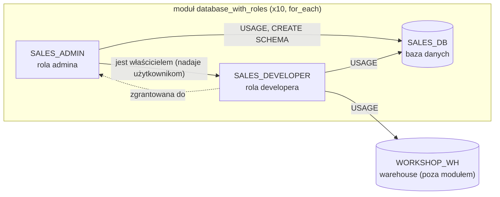

# Big Infrastructure dla Big Data: jak zarządzać skalą z Terraformem

Materiały do warsztatów dla początkujących. Na praktycznym przykładzie platformy **Snowflake** pokazujemy, jak **Infrastructure as Code (IaC)** i **Terraform** pomagają zapanować nad rosnącą liczbą środowisk, baz, ról i uprawnień - i dlaczego ręczne klikanie przestaje wystarczać.

## Czego możesz się nauczyć

- czym jest Infrastructure as Code i jakie problemy rozwiązuje,
- dlaczego zarządzanie infrastrukturą staje się wyzwaniem wraz ze wzrostem skali,
- jak działa Terraform: `init` → `validate` → `plan` → `apply` (i `destroy`), stan (state), providery,
- z jakich bloków składa się konfiguracja: `terraform`, `provider`, `resource`, `variable`, `locals`, `output`, `module`,
- jak zarządzać obiektami Snowflake z kodu: baza danych, warehouse, rola, uprawnienia,
- jak zapakować powtarzalny wzorzec w **moduł** i wdrożyć go 10 razy jednym `for_each`,
- jakie korzyści daje automatyzacja, standaryzacja i wersjonowanie konfiguracji.

## Co zbudujemy

W trzech krokach (`stages/`) dochodzimy do tego, że z jednej listy nazw baz danych Terraform tworzy komplet obiektów:



| Krok | Katalog | Temat |
|------|---------|-------|
| 1 | [stages/01-first-resources](stages/01-first-resources/README.md) | provider, zmienne, `locals`, zasoby: warehouse i baza danych |
| 2 | [stages/02-roles-and-grants](stages/02-roles-and-grants/README.md) | zasoby: rola i uprawnienia, zależności między zasobami |
| 3 | [stages/03-module-for-each](stages/03-module-for-each/README.md) | własny moduł i `for_each` na liście 10 baz |

Każdy krok jest **rozszerzeniem poprzedniego** (te same zasoby + nowe), więc wszystkie używają tego samego lokalnego stanu (`stages/terraform.tfstate`) i można je wykonywać po kolei bez sprzątania pomiędzy nimi.

> Katalog [presenter-notes](presenter-notes/README.md) zawiera notatki prowadzącego wygenerowane przy pomocy AI - uczestnicy nie muszą z nich korzystać.

## Wymagania

**Konta (darmowe):**

- GitHub (do pobrania repozytorium),
- Snowflake - konto próbne (trial).

**Narzędzia na komputerze:**

- [Git](https://git-scm.com/downloads) (na Windows razem z nim dostajesz też `openssl`),
- [Terraform](https://developer.hashicorp.com/terraform/install) w wersji 1.9 lub nowszej,
- edytor kodu, np. [VS Code](https://code.visualstudio.com/) z rozszerzeniem HashiCorp Terraform.

## Przygotowanie środowiska

Poniżej skrót. Szczegółowe instrukcje są w oficjalnej dokumentacji - linki przy każdym kroku.

### 1. Pobierz repozytorium

Wystarczy **sklonować** repozytorium - wszystkie komendy Terraforma uruchamiasz lokalnie, więc nic nie musisz wypychać na GitHuba.

```bash
git clone https://github.com/WojciechArendt/big-infra-tf-snf-workshop.git
cd big-infra-tf-snf-workshop
```

**Fork** ma sens tylko wtedy, gdy chcesz zapisywać własne zmiany na swoim koncie GitHub (kliknij **Fork** na stronie repozytorium, a następnie sklonuj swoją kopię). Repozytorium jest publiczne, ale modyfikować może je tylko autor.

### 2. Zainstaluj Terraform

Zgodnie z [instrukcją HashiCorp](https://developer.hashicorp.com/terraform/install), np.:

```bash
# Windows
winget install Hashicorp.Terraform
# macOS
brew tap hashicorp/tap && brew install hashicorp/tap/terraform
```

Sprawdź: `terraform version`.

### 3. Załóż konto próbne Snowflake

1. Wejdź na [signup.snowflake.com](https://signup.snowflake.com/) i załóż konto próbne (30 dni lub do wyczerpania kredytów, bez karty kredytowej). Dokumentacja: [Trial accounts](https://docs.snowflake.com/en/user-guide/admin-trial-account).
2. Wybierz dowolną chmurę i region, a edycję **Enterprise** lub **Standard** (do tych ćwiczeń różnica nie ma znaczenia).
3. Zaloguj się do Snowsight (interfejs webowy) - użytkownik, którego tworzysz przy rejestracji, ma rolę `ACCOUNTADMIN`.

### 4. Wygeneruj parę kluczy dla użytkownika Terraforma

Terraform będzie logował się do Snowflake kluczem (key-pair), bez hasła. Klucz generujesz lokalnie narzędziem `openssl`.

Otwórz terminal w **katalogu głównym repozytorium** (w VS Code: *Terminal → New Terminal*; na Windows wystarczy PowerShell) i wklej poniższe komendy - możesz wszystkie naraz. Utworzą katalog `keys/` (jest w `.gitignore`) z trzema plikami: kluczem prywatnym (`snowflake_tf.p8`), kluczem publicznym (`snowflake_tf.pub`) i plikiem pośrednim (`snowflake_tf_rsa.pem`).

```bash
mkdir keys
openssl genrsa -out keys/snowflake_tf_rsa.pem 2048
openssl pkcs8 -topk8 -inform PEM -in keys/snowflake_tf_rsa.pem -out keys/snowflake_tf.p8 -nocrypt
openssl rsa -in keys/snowflake_tf.p8 -pubout -out keys/snowflake_tf.pub
```

Jeśli terminal nie zna komendy `openssl` (częste w PowerShell na Windows), uruchom te same komendy w **Git Bash** (instaluje się razem z Gitem) albo użyj pełnej ścieżki, np. `& "C:\Program Files\Git\usr\bin\openssl.exe"`.

Klucz prywatny (`.p8`) jest bez hasła - to uproszczenie na potrzeby warsztatów. **Nigdy nie commituj kluczy.** Szczegóły: [Key-pair authentication](https://docs.snowflake.com/en/user-guide/key-pair-auth).

Następnie wypisz klucz publiczny w jednej linii, bez nagłówków - skopiuj wynik, będzie potrzebny w kroku 5:

```powershell
# PowerShell
(Get-Content keys/snowflake_tf.pub | Select-Object -Skip 1 | Select-Object -SkipLast 1) -join ""
```

```bash
# bash / zsh
grep -v "PUBLIC KEY" keys/snowflake_tf.pub | tr -d '\n'
```

### 5. Utwórz service usera dla Terraforma (bootstrap)

Terraform potrzebuje tożsamości, żeby połączyć się ze Snowflake, a ktoś musi ją utworzyć „z zewnątrz" - dlatego ten jeden krok robimy ręcznie.

1. W Snowsight otwórz nowy Worksheet i wklej zawartość [bootstrap/01_create_terraform_service_user.sql](bootstrap/01_create_terraform_service_user.sql).
2. Podmień `<WKLEJ_KLUCZ_PUBLICZNY>` na klucz z kroku 4.
3. Uruchom cały skrypt (rola `ACCOUNTADMIN`). Zapisz `organization_name` i `account_name` z wyniku pierwszego zapytania.

Nazwa `TERRAFORM_SVC`: przyrostek `_SVC` to skrót od *service* - konto serwisowe (nieinteraktywne), z którego korzysta narzędzie, a nie człowiek. To tylko konwencja nazewnicza; to `TYPE = SERVICE` w SQL sprawia, że użytkownik jest kontem serwisowym.

> **Uwaga:** skrypt nadaje użytkownikowi `TERRAFORM_SVC` rolę `ACCOUNTADMIN`. To **uproszczenie wyłącznie na potrzeby ćwiczeń** - w prawdziwym środowisku kontu automatyzacji nadaje się minimalne potrzebne uprawnienia (np. oddzielne role do tworzenia obiektów i do zarządzania dostępami), a nie rolę administratora konta.

### 6. Ustaw zmienne środowiskowe

Dane logowania nie trafiają do plików z kodem - provider czyta je ze zmiennych środowiskowych. Przygotowałem szablon z listą komend, które je ustawiają. Wykonaj kroki **po kolei** (poniższych bloków nie wklejaj naraz).

**a)** Skopiuj szablon (pliki `scripts/env.ps1` i `scripts/env.sh` są w `.gitignore`), z katalogu głównego repozytorium:

```powershell
# PowerShell
Copy-Item scripts/env.example.ps1 scripts/env.ps1
```

```bash
# bash / zsh
cp scripts/env.example.sh scripts/env.sh
```

**b)** Otwórz skopiowany plik w edytorze i podmień `<ORGANIZATION_NAME>` oraz `<ACCOUNT_NAME>` na wartości zapisane w kroku 5. Zapisz plik.

**c)** Załaduj zmienne w terminalu, nadal z katalogu głównego repozytorium:

```powershell
# PowerShell
. .\scripts\env.ps1
```

```bash
# bash / zsh
source ./scripts/env.sh
```

Plik skryptu nie jest konieczny - to tylko lista komend ustawiających zmienne. Możesz zamiast tego wkleić jego (uzupełnioną) zawartość prosto do terminala, też z katalogu głównego repozytorium. Plik jest po prostu wygodny, bo w nowym oknie terminala wystarczy wtedy jedna komenda zamiast wklejania wszystkiego od nowa.

Zmienne obowiązują tylko w bieżącym oknie terminala - w nowym oknie ustaw je ponownie (krok c).

### 7. Sprawdź, czy wszystko działa

```bash
cd stages/01-first-resources
terraform init
terraform plan
```

Jeśli `plan` kończy się komunikatem `Plan: 2 to add, 0 to change, 0 to destroy.` - jesteś gotowy/a na ćwiczenia.

## Ćwiczenia

Idź po kolei: [krok 1](stages/01-first-resources/README.md) → [krok 2](stages/02-roles-and-grants/README.md) → [krok 3](stages/03-module-for-each/README.md). W każdym katalogu `README.md` opisuje, co robimy i jakich komend użyć. Po przejściu do kolejnego katalogu uruchom w nim `terraform init` (każdy katalog inicjalizuje się osobno).

Podstawowy cykl pracy z Terraformem:

| Komenda | Co robi |
|---------|---------|
| `terraform init` | pobiera providery i moduły, konfiguruje backend (miejsce przechowywania stanu) |
| `terraform validate` | sprawdza poprawność składni i spójność konfiguracji (bez łączenia się ze Snowflake) |
| `terraform plan` | porównuje kod ze stanem i rzeczywistością, pokazuje **co się zmieni** - niczego nie zmienia |
| `terraform apply` | wykonuje zmiany po Twoim potwierdzeniu |
| `terraform destroy` | usuwa wszystkie zasoby zarządzane przez tę konfigurację |

> W prawdziwych projektach te komendy uruchamia pipeline CI/CD (np. GitHub Actions) po zatwierdzeniu zmian w kodzie. Na warsztatach robimy to ręcznie z terminala, żeby zobaczyć, co dokładnie robi każda komenda.

## Stan Terraforma (state)

Terraform zapisuje, jakimi obiektami zarządza, w pliku stanu. Na warsztatach jest to plik lokalny `stages/terraform.tfstate` (w `.gitignore`, nie trafia do repozytorium). **Nie usuwaj go** w trakcie ćwiczeń - bez niego Terraform nie wie, co już utworzył, i będzie próbował tworzyć obiekty od nowa.

W pracy zespołowej stan trzyma się w zdalnym backendzie ze wspólnym dostępem i blokadą równoległych zmian.

### Opcjonalnie: stan w HCP Terraform

Dla chętnych. Konto Free pozwala na zarządzanie do 500 zasobów ([limity planów](https://developer.hashicorp.com/terraform/cloud-docs/overview)) - wystarczy z zapasem.

1. Zarejestruj się zgodnie z [tutorialem HashiCorp](https://developer.hashicorp.com/terraform/tutorials/cloud-get-started/cloud-sign-up), utwórz organizację i workspace (CLI-driven workflow) o nazwie `snf-workshop`.
2. W *Settings → General* workspace'u ustaw **Execution Mode: Local** ([opis](https://developer.hashicorp.com/terraform/cloud-docs/workspaces/settings#execution-mode)) - polecenia nadal wykonują się u Ciebie, a HCP tylko przechowuje stan.
3. Zaloguj się: `terraform login` ([dokumentacja](https://developer.hashicorp.com/terraform/cli/commands/login)) i ustaw zmienną środowiskową `TF_CLOUD_ORGANIZATION` na nazwę organizacji.
4. W `versions.tf` zamień blok `backend "local"` na:

   ```hcl
   cloud {
     workspaces {
       name = "snf-workshop"
     }
   }
   ```

5. Uruchom `terraform init` (Terraform zaproponuje przeniesienie istniejącego stanu).

Zmień backend w taki sam sposób we wszystkich trzech krokach, zanim zaczniesz ich używać.

## Sprzątanie

Po zakończeniu ćwiczeń, z katalogu ostatniego wykonanego kroku (zwykle `stages/03-module-for-each`):

```bash
terraform destroy
```

Aby usunąć także użytkownika Terraforma: w Snowsight wykonaj `DROP USER TERRAFORM_SVC;`. Konto próbne Snowflake wygasa samo po 30 dniach.

## Rozwiązywanie problemów

| Objaw | Co sprawdzić |
|-------|--------------|
| `terraform: command not found` | Terraform nie jest zainstalowany lub terminal wymaga restartu po instalacji. |
| `JWT token is invalid` / `Incorrect username or password` | Zły `organization_name` / `account_name`; klucz publiczny w Snowflake nie pasuje do klucza prywatnego; sprawdź `DESC USER TERRAFORM_SVC` (pole `RSA_PUBLIC_KEY_FP`). |
| `object already exists` | Obiekt o tej nazwie już jest w koncie (utworzony ręcznie) albo usunąłeś/aś plik stanu `stages/terraform.tfstate`. Zmień nazwę w kodzie lub usuń obiekt. |
| Brak zmiennych po otwarciu nowego terminala | Załaduj ponownie `scripts/env.ps1` / `scripts/env.sh`. |
| `Backend initialization required` po przejściu do innego kroku | Uruchom `terraform init` w katalogu tego kroku. |

## Przydatne linki

**Terraform**
- Dobre praktyki (polecane): [terraform-best-practices.com](https://www.terraform-best-practices.com/)
- Dokumentacja języka: [developer.hashicorp.com/terraform/language](https://developer.hashicorp.com/terraform/language)
- Tutoriale: [developer.hashicorp.com/terraform/tutorials](https://developer.hashicorp.com/terraform/tutorials)
- HCP Terraform: [developer.hashicorp.com/terraform/cloud-docs](https://developer.hashicorp.com/terraform/cloud-docs)

**Snowflake + Terraform**
- Provider: [registry.terraform.io/providers/snowflakedb/snowflake](https://registry.terraform.io/providers/snowflakedb/snowflake/latest/docs)
- Metody uwierzytelniania providera: [authentication_methods](https://registry.terraform.io/providers/snowflakedb/snowflake/latest/docs/guides/authentication_methods)
- Identyfikatory kont: [Account identifiers](https://docs.snowflake.com/en/user-guide/admin-account-identifier)

**Alternatywy i dalsze kroki**
- Snowflake DCM Projects (deklaratywne zarządzanie obiektami Snowflake natywnie w Snowflake): [dokumentacja](https://docs.snowflake.com/en/user-guide/dcm-projects/dcm-projects-overview)

## Licencja

[MIT](LICENSE)
